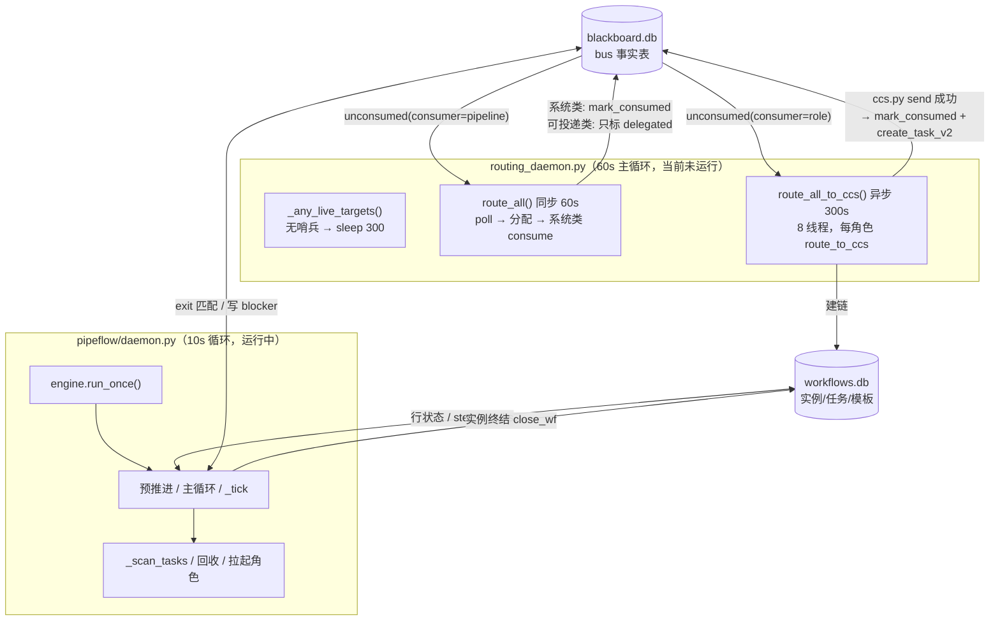
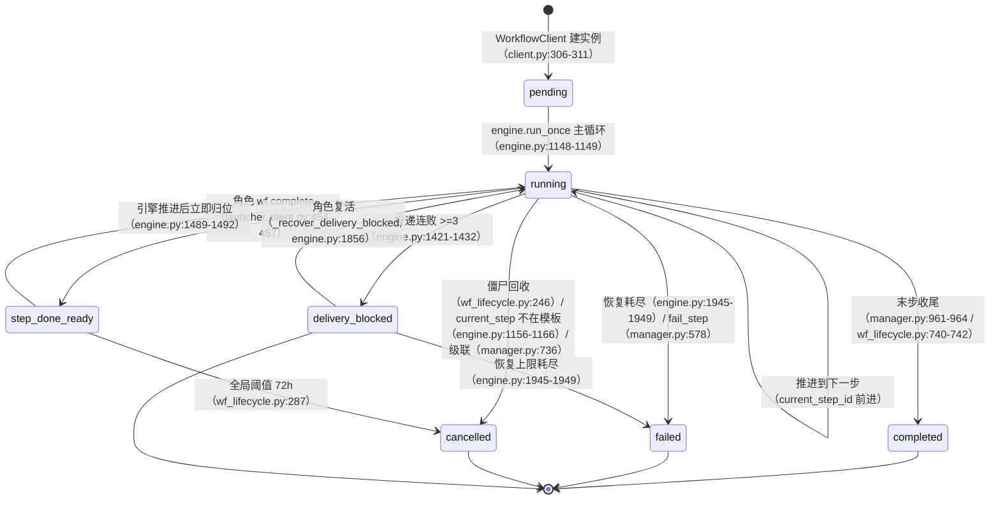

# session-pipeline 引擎实际逻辑（按代码取证）

> 本文只描述**代码当前实际行为**，不描述设计意图。每条断言后附 `file:line`。
> 旧文档（`ARCHITECTURE.md` / `TECHNICAL_DEEP_DIVE.md` / `SYSTEM_LANDSCAPE.md` /
> `collab-modes-implementation.md` / `WORKFLOW_TEMPLATE_SPEC.md`）一律按"嫌疑犯"处理，
> 差异集中列在 G 节。
>
> 取证时间 2026-11-03。只读操作：`grep` / `sed` / `sqlite3 mode=ro` / `pgrep` / `ls`。
> 未运行 `systemctl`、未启动服务、未改任何 `.py`。

## 0. 阅读边界：仓库树不是运行树

必须先说清楚，否则后文行号会被误当成"线上跑的代码"。

- 本仓库工作树：`/home/administrator/session-pipeline`，分支 `temp-pr-branch`，HEAD `0aed2c3`。
- 实际运行树：`/home/administrator/wt-live`，HEAD `b9db1ec`，**比本树新 336 个提交**
  （`git -C ~/wt-live merge-base --is-ancestor 0aed2c3 HEAD` 为真；
  `git -C ~/wt-live rev-list --count 0aed2c3..HEAD` = 336）。
- 单文件行数已分叉：`step_handler.py` 1745 vs 2246；`engine.py` 2070 vs 2216；
  `wf_lifecycle.py` 2176 vs 2344；`manager.py` 1149 vs 1170；`liveness.py` 571 vs 633；
  `routes.py` 661 vs 670。
- systemd drop-in 把两个服务都指向运行树：
  `~/.config/systemd/user/workflow-engine.service.d/20-live-tree.conf:6`
  `ExecStart=/home/administrator/miniforge3/bin/python3 -u /home/administrator/~/wt-live/src/pipeflow/daemon.py --interval 10`；
  `session-pipeline-daemon.service.d/20-live-tree.conf:10` 同样指向 `~/wt-live/src/routing_daemon.py`。

因此本文所有 `file:line` 指向仓库 `0aed2c3`，与线上代码有已知差异。结构性结论（生命周期、
状态存储、判据体系、跨仓库接口）我在运行树上抽查复核过：
`_CLOSE_STATUSES`（`~/wt-live/src/lifecycle/manager.py:672`）、
`wait_roles` 逐角色补查循环（`~/wt-live/src/pipeflow/step_handler.py:2220`）、
pipeline 全树 grep `ALLOWED_ROLES` 与四角色字面量均 0 命中（`~/wt-live/src` 同结果）。
涉及行号与行数的细节以本树为准并注明。

**实测进程状态**（`pgrep -af`，只读）：只有 `pipeflow/daemon.py` 在跑
（PID 1013237，`/home/administrator/~/wt-live/src/pipeflow/daemon.py --interval 10`）。
`routing_daemon` **没有存活进程**；`~/.config/systemd/user/default.target.wants/` 里
只有 `workflow-engine.service`，**没有** `session-pipeline-daemon.service`。
即当前生产上"路由分发"这一半是停的，只有"工作流推进"这一半在跑。
本条未用 `systemctl` 验证（任务禁止），仅据进程表与 wants 目录判断。

---

## A. 一条消息进来后发生什么

### A.1 入口是两个互不依赖的循环



两条路径的关键差别：`route_all` 是**同步**的（主循环内直接跑完，失败按 5s 递增退避），
`route_all_to_ccs` 是**异步**的（线程池并发，每角色独立超时，互不阻塞），
而 `run_once` 是**另一个进程**、另一套定时器（10s）。三者唯一共享的是那两张 SQLite 表。

`routing_daemon.py:10-12` 的模块 docstring 明确职责分离：本 daemon = 消息路由分发
（bus → 角色），workflow daemon = 工作流步骤推进（`engine.run_once`）。
两者通过 SQLite（`~/.hermes/state/workflows.db`）与 Blackboard 耦合。

### A.2 同步路径（`routing_daemon` 主循环内，每 60s）

```
while True:                                        routing_daemon.py:300
  if not _any_live_targets(): sleep(300); continue  :301-304 / :121-130
  route_all()                                       :307
    ├─ poll_unconsumed(consumer="pipeline")         routes.py:200 → polling.py:16
    │    └─ CIRCUIT_BREAKER.call(_do_poll)          polling.py:56
    ├─ 逐条算 consumers；@role 定向求交              routes.py:228-232
    ├─ 超过 STALE_AFTER_S=6h → 跳过                  routes.py:175 / :216-227
    ├─ 系统类（_SYSTEM_CATEGORIES）→ 直接 consume    routes.py:289 / :298-302
    ├─ 可投递类 → status="delegated"，**不 consume** routes.py:296-297
    └─ 全部角色无 error 才 bb.mark_consumed(fid)     routes.py:354-356
  error_backoff = min(+5, 120)                      routing_daemon.py:331
  sleep(INTERVAL + error_backoff)                   routing_daemon.py:604
```

两类消息被 `routes.py:289` 一刀切开：

- **可投递类**在 `route_all` 只标 `delegated` 就 `continue`，**不写 consume**。原因写在
  `routes.py:290-295`：consume 会把 `(fact, role)` 从 `route_to_ccs` 的候选集里删掉，
  而 `poll_unconsumed` 用的是 `NOT EXISTS consume` 视图（`polling.py:24-28`），
  删了之后"忙→下轮再试"永远轮不到。实测 3h 内 200 条 consume 只有 51 条进 pane，
  149 条静默丢失（同处注释引 #436146）。
- **系统类**（`_SYSTEM_CATEGORIES`，`routes.py:44-63`）直接
  `IDEMPOTENT_CONSUME.safe_consume`，不需要投递。

**`route_all` 里的建链代码是死代码。** `routes.py:310` 的条件是
`if ack_status == "consumed" and cat not in _SYSTEM_CATEGORIES:`，但能走到这一行说明
`cat in _SYSTEM_CATEGORIES`（否则 :289 已 `continue`），两个条件互斥，
`:313-341` 那段 `create_task_v2` 永不执行（缩进核实：:289 与 :310 同为 24 空格，是同级 `if`）。
`routes.py:598` 的注释也印证："route_all 的可投递类在 delegated 分支就 continue"。
**唯一活着的建链路径是 `route_to_ccs`（`:605-610`）。**

### A.3 异步路径一：投递到角色 pane（每 300s，`CCS_INTERVAL`）

`routing_daemon.py:336-358` → `route_all_to_ccs()`（`routes.py:625`）→ 线程池
`max_workers=min(8, len(roles))`（`routes.py:636`）→ 每角色 `route_to_ccs(role)`：

```
route_to_ccs(role_name)                            routes.py:395
  ├─ _poll(consumer=role_name, limit=30)            routes.py:406
  ├─ _is_for_me(msg)：self-echo + @tag + 分类订阅    routes.py:425-445
  ├─ _is_running(role) → subprocess status-role     routes.py:471-480（timeout=10）
  ├─ wf_busy = WorkflowClient(role).check_task()    routes.py:490-497
  │    忙 → 跳过不投、不 consume                     routes.py:536-539
  ├─ validate_output(role, cat, json(text))         routes.py:544
  │    缺字段且 severity=error → 写 notice + rejected routes.py:545-552
  ├─ _send(role, body) → subprocess ccs.py send     routes.py:455-469（timeout=15）
  │    成功 → mark_consumed(fid, role_name)         routes.py:566-571
  │          → 建链闸门 → create_task_v2(...)        routes.py:577-610
  └─ 失败/忙 → 不 consume，下轮重试
```

建链闸门四道（`routes.py:590-604`）：标题 `len<8` 或无内容词 / `[角色名]` 开头的产出汇报 /
`wf_` 回声标题 / no-op 健康报告。四道都过才建链，且 `initiator_role="system"`（`routes.py:608`）。

### A.4 异步路径二：工作流推进（独立进程，每 10s）

`pipeflow/daemon.py --interval 10`（`workflow-engine.service.d/20-live-tree.conf:6`）。
单轮结构见 B.3。

### A.5 路由优先级

`priority(category)` = `CATEGORY_PRIORITY.get(category, 11)`（`routing/router.py:65-67`），
`CATEGORY_PRIORITY` 从 `~/.hermes/data/bus_canonical.json` 的 `categories[*].priority` 推导
（`router.py:53-56`）。数值在数据文件里，代码只硬编码默认值 11（`router.py:57`）。

### A.6 路由表来源

`Router._load_from_db_or_build()`（`router.py:85-97`）优先读 `routing.db`，角色数低于
`_DB_MIN_ROLES`（默认 5，`router.py:72`）时回退 `~/.hermes/data/roles_export.json`
（`router.py:25-33`）。Router 是进程内单例（`get_router`，`router.py:269`），
改角色定义后必须重启进程。

---

## B. 工作流实例生命周期

### B.1 `wf_lifecycle.py` 与 `lifecycle/manager.py` 的分工

不是"上层封装下层"，是**两套并行的写路径**，共用 `workflows.db`：

| | `lifecycle/manager.py`（1149 行） | `pipeflow/wf_lifecycle.py`（2176 行） |
|---|---|---|
| 定位 | 状态机 + 步骤类型分派 + 事务 | 引擎运维 mixin：推进 / 回收 / 降级 / 子链 |
| 建实例 | 不建；`start_wf`（:225）把 `pending` 改 `running` | 不建（`WorkflowClient` 建，`workflow/client.py:306-311`） |
| 完成步骤 | `complete_step`（:284）→ 6 个 `_complete_*_unsafe` | 不走这里 |
| 推进 | `_advance_unsafe`（:939）——角色侧 `wf complete` 触发的路径 | `_advance_production_wf`（:527）——引擎 tick 路径 |
| 收尾 | `close_wf`（:664），终态互斥 + 子链级联（`:736`） | 调 `close_wf` |
| 回收 | 无 | `_cleanup_stale_workflows`（:246）、`_cleanup_orphan_tasks`（:217） |
| 锁 | `threading.RLock` + `BEGIN IMMEDIATE`（`complete_step` :285-286） | 大量裸 `conn.execute` |

两条推进路径各带一份驳回门禁（`manager.py:967-975` 与 `wf_lifecycle.py:553` 起），
注释互相点名：只装一条，走另一条路径的驳回会被无视（`manager.py:969-973` 记录了
`wf_98a18e738d` 判 CHANGES_REQUESTED 却推进到 s4 的实测）。

裸 SQL 规模（本树实测，命令 `grep -coE '[a-z_]*conn\.execute' <file>`）：
`wf_lifecycle.py` **20** 处、`task_generator.py` **19** 处、`step_handler.py` 0、
`engine.py` 0（改走 `lm.execute`，16 处）。旧文档写 21 处，口径不同（见 G 节 #5）。

### B.2 状态图



**终态 4 个**：`completed` / `cancelled` / `failed` / `delivery_blocked`
（`manager.py:662`）。终态不可逆：`close_wf` 里 `_CLOSE_STATUSES` 互斥守卫，
不同终态禁止互覆（`manager.py:665-705`）。

**自动迁移**（引擎自己就能走）：`pending→running`（`engine.py:1148-1149`）、
`running→cancelled`（超时/回收）、`delivery_blocked→running`（角色复活）、
`delivery_blocked→failed`（恢复耗尽）。

**必须外部触发**：`running→step_done_ready` 只能由**角色侧**写。pipeline 内部
`_set_step_result_unsafe` 只改 `step_results` JSON、不动行状态（`manager.py:784`），
写行级 `status='step_done_ready'` 的是 **launcher** 的
`session-launcher/src/workflow/client.py:454-457`（`_update_if_mutable` 带终态守卫）。
两个仓库共写同一张表，这是 B 节最容易漏掉的一点。

**状态集合三处不一致**（都真实存在于代码）：

- `WF_STATUSES = {"pending","running","completed","failed","cancelled"}`（`manager.py:62`）
  ——**缺** `step_done_ready` 与 `delivery_blocked`。
- `STEP_STATUSES = {"pending","running","step_done_ready","completed","failed"}`（`manager.py:63`）
  ——缺 `notified`、`blocked`、`delivery_blocked`。
- `STEP_TYPES = {"handoff","review","single","gate","notify"}`（`manager.py:64`）
  ——**缺** `subflow`，但同文件 `:335` 的分派字典有 `"subflow": _complete_subflow_unsafe`，
  模板 schema 的 enum 也有（`template_registry.py:110`）。

**实测分布**（`sqlite3 mode=ro` 查 `workflows.db`）：`completed 498 / cancelled 486 /
failed 266`，合计 1250，**当前 0 条在飞实例**。

### B.3 `run_once` 单轮顺序（`engine.py:1043`）

1. `_load_workflows()`（:1046）每 tick 重载模板（目录 `HERMES_WORKFLOWS`，`engine.py:31`）。
2. `_recover_delivery_blocked()`（:1052，实现 :1856）。
3. `_cleanup_stale_workflows(...)`（:1058）。
4. `_cleanup_orphan_tasks(...)`（:1065）。
5. **预推进**：扫 `running`/`step_done_ready`（:1078-1081），对
   `step_results[cur].status ∈ {step_done_ready, completed}` 直接 `_advance_production_wf`
   + `_remind_step_done`（:1099-1108），预算 `_TICK_BUDGET_SEC=60`（:411），断点
   `_prepass_resume_id`（:1080）。
6. `_ensure_guard_roles(deadline=now+_GUARD_BUDGET_SEC)`（:1111，`_GUARD_BUDGET_SEC=30` :416）。
7. 提前 `_scan_tasks()`（:1116）。
8. 主循环：`SELECT ... WHERE status IN ('pending','running','step_done_ready')`（:1133-1135），
   `_rotate_after` + 60s 预算（:1137-1146）。pending 先改 running（:1148-1149）。
   模板缺失或当前步不在模板 → `close_wf(cancelled)`（:1156-1166）。
   行/步状态对账后进入投递或推进分支（:1170-1189）。
9. 循环后：超预算则跳过 `_scan_tasks`（:1734-1740）；`_kick_stalled_roles()`
   （`role_lifecycle.py:511`）、`_check_context_overflow()`（`role_lifecycle.py:435`）、
   `_recover_rate_limited_roles()`（`role_lifecycle.py:319`）。

**推进后立即回写 `running`**（`engine.py:1489-1492`），注释解释：不写回的话角色重复
`wf complete` 会把行状态打回 `step_done_ready`，实例被重复推进。

### B.4 状态到底存在哪里

| 数据 | 位置 | 证据 |
|---|---|---|
| 实例行状态、当前步、step_results | `~/.hermes/state/workflows.db` 表 `workflow_instances` | `workflow/db.py:25-41` |
| 任务状态 | 同库 `tasks` | `workflow/db.py:42`；`workflow/sync.py:14-40` |
| 操作日志 | 同库 `workflow_logs` | `workflow/db.py:59`；`manager.py:776` |
| 模板（磁盘权威） | `~/.hermes/workflows/*.json`（实测 28 个） | `paths.py:69`；`engine.py:482` |
| 模板（DB 快照） | `workflow_templates`（实测 45 行，39 条 active） | `engine.py:801` `_upsert_template` |
| 消息 / 证据 | `~/.hermes/sister_bus/blackboard.db` | `bus_protocol.Blackboard` |
| 存活探针 | `~/.hermes/run/ccs-health/*.json`（实测 26 文件） | `liveness.py:35`；`survival_monitor.py:29` |
| CCS 运行状态 | `~/.hermes/run/ccs-sentinels/*.json`（27 文件，含 `engineer-1..9` 等实例名） | `paths.py:61-62` |
| 引擎内存态 | `_workflows`、`_loop_resume_id`、`_prepass_resume_id`、`_consumed_exit_ids` | `engine.py:462-471` |

内存态在崩溃或 `os.execv` 热重载后丢失，但只影响遍历起点：
注释明说"要抗重载就得把锚点落库，届时再改"（`engine.py:466-469`）。
DB 是唯一真相源，`step_results` 里的 `poll_since` / `bus_anchor` / `timeout_count` /
`queued_since` 都持久化（`step_handler.py:1269` `_sync_step_results`）。

---

## C. 步骤执行

### C.1 单 step 的处理链

`engine.run_once` 主循环把实例交给 `_tick(run, step)`（`step_handler.py:388`）。
不是直线流水，是**多阶段早退**：

```
_tick(run, step)                                      step_handler.py:388
 0. run.status ∈ {completed, cancelled, step_done_ready} → return   :391-392
 1. 解析 exit_condition；_eff_role（engineer↔pg 分流）              :393-400
 2. 双锚点 poll_since / bus_anchor，下限 max(anchor, run.created_at) :404-420
 3. 旧产物抢救：exit_messages 已存在 → 过 _quality_gate_blocks → complete_step
    → return（不 fall-through，防重复 complete）                     :424-462
 4. tmux 信号：只消费 idle_complaint / violation，**step_completed 不推进**  :462-548
 5. Timeout：elapsed >= timeout → 角色忙则先做 exit 匹配；否则 timeout_count++  :552-620
 6. busy 排队：queued/queued_since 累加后返回                        :604-675
 7. dual_node 抢救（node1 → codex 审查 → node2 `-codex-approved`）   :787
 8. 宽松推进（需 task_spec 锚点 + 完整 wf id，且 not wait_roles）     :817-836
 9. 完整性提醒（pipeflow/integrity.py，回复含 `{step_id}-integrity-approved`）:902
10. exit 匹配：_check_exit(...) → 命中则写 bus_anchor/exit_messages
    → _quality_gate_blocks → complete_step → 空转检测 → report_idle   :1086-1131
11. completion_check 兜底（gate 类型）                                :1160-1211
```

### C.2 "判据"一共有五套，互不覆盖

| 判据 | 定义处 | 谁判 | 失败后果 |
|---|---|---|---|
| `exit_condition`（cat / source_contains / text_contains / require_wf / timeout_minutes / integrity_interval_sec） | `Step.exit_condition`（`engine.py:335`） | `_check_exit`（`step_handler.py:1613`） | 不推进，直到超时 |
| `exit_schema` | `Step.exit_schema`（`engine.py:349`） | `_quality_gate_blocks` → `_validate_exit_schema`（`step_handler.py:1393` / :1440） | 写 blocker + 不推进 |
| `verify`（shell 命令） | `Step.verify`（`engine.py:341`） | `_quality_gate_blocks` 里 `subprocess.run(vcmd, shell=True, timeout=30)`（`step_handler.py:1418`），context 值先 `shlex.quote`（:1415） | 写 blocker + 不推进 |
| `completion_check.output_exists` | `Step.completion_check`（`engine.py:337`） | `manager._check_gate_condition`（`manager.py:918`） | gate 步骤 blocked；**全部条目不可判定时放行并 warning**（:924-933） |
| persona `eval_criteria`（`验证:` 后的命令） | persona JSON | `eval_checker.run_eval_check`（:1444），由 `routing_daemon` 每 600s 抽样 | 写 bus `verification` + `notice`/`blocker`；不阻塞任何工作流 |

`eval_criteria` 与工作流推进**完全解耦**：均匀抽 2 个角色做通用检查 + 按可达判据数加权抽
判据检查（`eval_checker.py:1470-1479`，窗口 `CRITERIA_WINDOW=3`）。白名单拒绝（rc=-3，
`eval_checker.py:328`）与 python 沙箱阻断（rc=-4，:368）记 `skipped` 不记 FAIL（:1491-1495）。

`_check_gate_condition` 的放行分支值得单记：`output_exists` 全是"变更代码文件"这类
不可判定条目时返回 `(True, ...)` 并打 warning（`manager.py:925-933`）。理由是
`blocked` 不在 `STEP_STATUSES` / `_ACTIVE_STEP_STATUS` 里，回收扫描覆盖不到，
硬 blocked 会让步骤与实例双双搁浅（只剩 24h 全局阈值兜底）。

### C.3 `output_validator.py` 与 `task_evidence.py` 都不在 step 链上

- `validate_output` 唯一调用点是 `routes.py:544`（投递**前**的结构 lint）。它只查 persona
  `output_schema` 的必填字段，docstring 明写"绝不背书内容质量…质量判断只能由人读对话得出"
  （`output_validator.py:42-47`）。`severity=error` 时消息被 reject、不投递。
- `task_evidence.evaluate_and_feedback` 唯一调用点是 `task_generator.py:600-603`，
  在 `_scan_tasks` 尾部每轮 run_once 跑一次；只评估最近 1 小时完成的任务
  （`task_evidence.py:156`），按 task_id 查 bus 证据（:168），结果写 bus，**不改任何工作流状态**。

把这两者画进"步骤执行链"的旧文档不准确（见 G 节 #6）。

### C.4 `collab-modes-implementation.md` 的 guard / wait_roles 对应哪个函数

| 文档声明 | 实际实现 | 证据 |
|---|---|---|
| `guard` 由 `_collect_guard_roles` / `_ensure_guard_roles` 实现 | 成立 | `engine.py:1787`、`engine.py:1827` |
| `wait_roles` 由 `_check_exit` 实现 | 成立 | `step_handler.py:1720-1745` |
| 模板未声明 `guard` 时从 persona `collab` 注入 | 成立 | `engine.py:525-537` |
| `wait_roles` 不从 persona 注入 | 成立 | 全文件搜索只有模板来源 |
| 非法 `guard.watch` → 丢弃整个 guard | 成立 | `engine.py:540-544` |
| 非法或空 `wait_roles` → 置 None | 成立，空列表也置 None 并告警 | `engine.py:545-552` |
| 协作门 == `set(wait_roles).issubset(have)` | **概念等价，实现不同** | `step_handler.py:1721-1741` |
| 生产上无模板非空使用 `wait_roles` | 成立（JSON 与 DB 双向验证，见 D.4） | — |

`wait_roles` 的真实实现（`step_handler.py:1720-1741`）：
`have = {m["src"] for m in matched}` → `missing = set(wait_roles) - have` →
对每个 `missing` 角色按 `bb.read(cat, limit=200)` 补查，**精确匹配 `_f.src == _r`
且不放宽到 claude**（注释 :1727-1728：一条 claude-src 消息会一票满足所有缺失角色），
任一角色找不到就 `return (0.0, [])`。主查询路径反过来是放行 `src=claude` 的
（`step_handler.py:1628-1635` docstring），两条路径刻意不对称。

---

## D. 模板与角色绑定

### D.1 `template_registry.py` 注册了什么

它**不注册角色模板**。做三件事：

1. **结构校验** `_validate_schema`（`template_registry.py:161`），步骤 `type` 枚举
   `["handoff","review","single","gate","notify","subflow"]`（:110）。
2. **质量校验** `_validate_meta`（:298）——三段式「做什么/怎么做/验收标准」+`## 完成`+≥150B
   （`_validate_step_content` :337-367）。`register()` 只把 schema 与角色存在性错误当硬错
   （:555-563），meta 问题仅 warning（:568）。
3. **模板推荐** `recommend()`（:711），`trigger_scene` 全匹配 +10 / 子串 +5 / 2-gram 重叠打分；
   跳过 `is_active=0`、`_is_test_harness`（:280-289，前缀 `test_/exit_schema/role_interact/drill`）
   与 `_meta_hard_errors`。

角色名单来自 persona 目录动态扫描：`_load_role_registry()`（:38-55）读
`SESSION_ROLES_PERSONAS/persona_*.json`（`paths.py:66`）的 `assignee` 或 `name`。
实测目录下 **19** 个 persona 文件。

`_cli_validate_all`（:848-875）只 print，**不 `sys.exit`**，故 `validate-all` 返回码恒为 0。

### D.2 "是否残留 19 角色模板"

**准确结论：注册表里没有"19 个角色模板"这种对象。28 个模板文件绑定 16 个角色，
其中 12 个在白名单外；22 个模板至少涉及一个白名单外角色。**

白名单来自 `~/session-launcher/CLAUDE.md`：`scout`、`engineer`、`reviewer`、`closer`
（"其他角色不启动、不派单、不修复"）。

实测（解析 28 个 `~/.hermes/workflows/*.json` 的 `steps[].target_role`）：

| 角色 | 步骤数 | 涉及模板数 | 白名单 |
|---|---|---|---|
| product_architect | 12 | 8 | ❌ |
| coordinator | 11 | 4 | ❌ |
| engineer | 10 | 8 | ✅ |
| qa | 10 | 8 | ❌ |
| reviewer | 9 | 8 | ✅ |
| pm | 6 | 4 | ❌ |
| closer | 5 | 3 | ✅ |
| scout | 4 | 2 | ✅ |
| lr | 4 | 2 | ❌ |
| devops | 3 | 2 | ❌ |
| knowledge_curator | 3 | 1 | ❌ |
| maintainer | 3 | 1 | ❌ |
| security_auditor | 3 | 1 | ❌ |
| pg | 2 | 2 | ❌ |
| writer | 2 | 2 | ❌ |
| consumer | 1 | 1 | ❌ |

共 16 个角色，12 个在白名单外。触及白名单外角色的 22 个模板（按 JSON `name`）：
`文档驱动5阶段工作流`、`architect_full_design`、`architect_review`、`consumer_bus_processing`、
`coordinator_dispatch`、`coordinator_schedule`、`coordinator_standup`、`dev_with_collab`、
`devops_deploy_plan`、`food_chain_loop`、`full_dev_pipeline`、`knowledge_sync`、
`lr_tech_decision`、`maintainer_health_monitor`、`pm_requirements`、`产品交付全流程`、
`qa_test_execute`、`qa_test_plan`、`security_audit_scan`、`writer_document`、
`技术实现`、`需求流转`。

### D.3 这些模板还能不能被触发

**能，pipeline 侧没有任何拦截。** 证据：

1. `recommend()` 只用 `allowed_initiators` / `allowed_executors` 过滤，而
   `system` / `pipeline` 发起者跳过 initiator 检查（`template_registry.py:753-754`）。
   `route_to_ccs` 建链时传的正是 `initiator_role="system"`（`routes.py:608`）。
2. 全树 grep `ALLOWED_ROLES` 与四角色字面量：**0 命中**（唯一的白名单是
   `p0_exemption.py:23/25` 的 P0 权限表，与模板无关）。`engine._load_workflows`、
   `_scan_tasks`、`route_to_ccs` 都不按白名单过滤。
3. `_ensure_guard_roles` 对任何 `target_role` / `guard.watch` / `wait_roles` 调
   `_ensure_role_alive` → `ccs.py start`（`engine.py:1800-1822` + `role_lifecycle.py:625-692`），
   白名单外角色照样被拉起。
4. DB 里 `workflow_templates` 45 行、39 条 `is_active=1`，`WF-*` / `WL-*` / 裸名三套命名并存
   （如 `WF-architect_review` 与 `architect_review`、`WL-full_dev_pipeline` 与
   `full_dev_pipeline`），全部 active。

结论：**收缩宪法在 launcher 侧生效，在 pipeline 侧未落地。** 只要 bus 上出现匹配
`trigger_scene` 的消息，`product_architect` / `coordinator` / `qa` 等模板仍会被自动选中建链、
被引擎拉起。这是 D 节最重要的发现。

### D.4 subflow 与 guard / wait_roles 的生产使用

- `subflow_template` 非空的 JSON 模板 **6 个**：`architect_review`、`coordinator_schedule`、
  `dev_implement`、`food_chain_loop`、`full_dev_pipeline`、`产品交付全流程`。
  DB 里带子链的模板行 **10 条**（含 `WF-*` / `WL-*` 副本）。
- **没有活跃模板使用 `"type": "subflow"`**（28 个 JSON 全扫 0 命中）。子链由
  `_subflow_takeover`（`wf_lifecycle.py:913`）按 `subflow_template` 现场创建；
  `subflow` 这个 type 只留在 `manager.py:335` 的分派字典与 `manager.py:439-442` 的确认分支里。
- `guard`：JSON 声明只有两处 —— `food_chain_loop.json` 的 s2
  `{"watch":["engineer","qa"],"auto_restart":true}` 与 `dev_with_collab.json` 的 s1
  `{"watch":["reviewer","qa"],"auto_restart":true}`。
- `wait_roles`：**JSON 与 DB 都是零**。`dev_with_collab.json` 里出现 `wait_roles` 只有
  一处——第 4 行的 `description` 文本（"验证 guard（主从）+ wait_roles（对等/仲裁）…"），
  解析其 4 个 step 全部为 `None`。DB 侧 110 个 step 带这个键（客户端序列化了所有字段），
  但**非空值 0 条**。旧文档这句是对的。
- 但运行期 guard 覆盖面远大于 2 个模板：**19/19 个 persona 都带 `collab.guard.watch`**
  （逐个解析 `personas/session-roles/persona_*.json` 确认，如
  `persona_05_engineer.json` → `["qa","reviewer"]`、`persona_01_scout.json` → `["pm"]`），
  经 `engine.py:525-537` 注入到未显式声明 guard 的模板步骤上。所以"只有两个模板用 guard"
  只说对了模板层。

---

## E. 故障与恢复

### E.1 崩溃后如何恢复

没有检查点文件，恢复靠**SQLite 行状态 + 幂等 tick**：

- 引擎崩溃：unit 的 `Restart=always` / `RestartSec=10` / `RestartMaxDelaySec=60`
  （`workflow-engine.service:11-13`）+ `run_once` 每轮重查
  `pending/running/step_done_ready`。内存游标丢失只影响遍历起点。
- 卡死看门狗：`faulthandler.dump_traceback_later(_TICK_STACK_DUMP_SEC)`（`daemon.py:421`）。
- 源码热重载：`daemon.py:446-473` 比较 `src` 目录 mtime，冷却后 `os.execv`；
  `_reload_decision`（:71）是纯函数，限速期丢弃的新 mtime 记进 `_pending_mtime` 下轮再判。
- 单实例锁：`routing_daemon.py:287` `fcntl.flock(LOCK_EX|LOCK_NB)`；
  `pipeflow/daemon.py:332` `_acquire_flock()`。
- 投递失败：`delivery_fail_count` 累计 3 次 → 步级 `delivery_blocked` + 行级
  `delivery_blocked`（`engine.py:1421-1432` 与 :1445-1453）。角色复活后
  `_recover_delivery_blocked`（:1856）重置重试；恢复次数耗尽 →
  `UPDATE ... status='failed' WHERE status IN ('delivery_blocked','pending','running','step_done_ready')`
  + blocker（:1945-1956）。该函数以**行级 status** 为候选判据，注释说明旧版用
  `step_results LIKE` 会自致盲（恢复把步级 status 抹成 `""` 后 LIKE 必失配，实测 15 条永久搁浅）。
- 僵尸回收：`_cleanup_stale_workflows`（`wf_lifecycle.py:246`）——最小存活 300s（:282），
  阈值 `step_done_ready=72h / 其余 24h`（:287），被模板 `max_duration_hours` 收紧（:293-294），
  `loop.enabled` 模板放宽到 72h（:305-307），阈值可到 2 倍做缓刑（:357-361）。
  条件 4 要求 `(timeout_count>=1 或 queued 达降级线)` **且** pane 静默 **且**
  `not _role_producing_recently`（:419-424），防误杀活体角色。

### E.2 五个"可靠性相关"模块的真实分工（互不重叠）

| 模块 | 角色 | 关键点 |
|---|---|---|
| `reliability_core.py`（383 行） | **实现层** | `JsonFormatter`(:33)、`with_retry`(:110)、`CircuitBreaker`(:149)、`ConsumerHeartbeat`(:231)、`TtlPruner`(:267)、`MetricsCollector`(:315)。纯工具，不读配置 |
| `reliability.py`（433 行） | **配置/实例层** | `reconfigure()`(:40-97) 从 `config/config.yaml` 读块并构造全局实例；`GracefulShutdown`(:103)、`health_check`(:151)、`IdempotentConsume`(:204)、`AckTracker`(:290)。`from reliability_core import ...`(:6-11) |
| `liveness.py`（571 行） | **纯函数判活库** L0-L4 | 零状态。`role_liveness`(:417) 统一入口；`_s0_alive`(:125) 用 tmux has-session + 哨兵文件分 `alive/unknown/orphan/dead`；`_s1_thinking`(:142) / `_s2_producing`(:150) 读 health 文件；`tmux_pane_active`(:501) 读 `#{window_activity}`；`pane_cli_busy`(:550)；`effective_role`(:172) 解析 engineer↔pg 分流 |
| `routing/survival_monitor.py`（614 行） | **巡检器 = health 文件的写者** | `tick()`(:403) 每 120s 由 `routing_daemon` 调用，写 `ccs-health/*.json`（`survival_l2_thinking` / `survival_l3_producing` / `survival_overall`）。不做决策 |
| `drift_detector.py`（205 行） | 角色输出分类 vs persona `output_targets` 的 XOR 检测 | `detect_all_drift`(:137) / `report_drift`(:157)；`_ALWAYS_ALLOWED`(:48-49)；每 3600s 由 `routing_daemon` 调用；不参与推进 |

依赖是线性的：`survival_monitor` **写** health → `liveness` **读** health 判活 →
`role_lifecycle` / `step_handler` 用 `liveness` 的结果决定投递、排队、拉起。
`reliability*` 与它们无关，只服务 bus 读写与指标。

`liveness.role_liveness` 有一处反直觉逻辑值得记：健康门控判 idle 时，若 `level>=4` 且
L4 DB 步骤扫描显示 `busy=True`，**不 short-circuit** 回 `busy=False`（`liveness.py:441-446`）。
注释理由：否则真在干活的角色被漏判 idle，`step_handler` 误走 `delivery_blocked`。

### E.3 daemon / service 清单

| 单元 | ExecStart | 判定 | 实测 |
|---|---|---|---|
| user `workflow-engine.service` | `~/wt-live/src/pipeflow/daemon.py --interval 10` | **必需**（唯一推进循环） | 在 `default.target.wants/`；进程在跑（PID 1013237） |
| user `session-pipeline-daemon.service` | `~/wt-live/src/routing_daemon.py` | **必需**（唯一路由分发） | **不在 `default.target.wants/`**；**无进程** |
| `/etc/systemd/system/session-pipeline.service` | `pipeflow/daemon.py --interval 10` | **历史遗留** | 文件存在（784B）；不在 `multi-user.target.wants/`；与 user `workflow-engine` 同程序不同树，双启会抢锁 |
| `/etc/systemd/system/session-routing.service` | — | **已停用** | 是 `/dev/null` 的符号链接；同目录另有 `session-routing.service.disabled`（610B） |
| user `cron-worker.service` | `~/.hermes/scripts/cron_worker_wrapper.py` | 非 pipeline 所有 | 在 `default.target.wants/` |
| `skill-sync` / `hermes-gateway` / `memory-server-dkk` / `memory-server-ssk` / `sister-agent-*` / `ccs@consumer|engineer|scout` | 各自程序 | 非 pipeline 所有 | 均在 `default.target.wants/` |
| `~/.hermes/run/ccs-lifecycle-sentinels/` | — | 空目录（**0 文件**） | 路径定义在 `paths.py:63`，当前无人写 |

`cron_scheduler.py` **没有调度触发器**：`CronScheduler` 只有 `__init__`(:48)、`_load_roles`(:58)、
`_load_idle_state`(:77)、`_save_idle_state`(:88)、`report_idle`(:98)、`_noop_delta`(:113)。
真正的 cron 触发在 `routing_daemon._check_cron_schedules()`（:133，每 300s，
用 croniter 匹配 persona `cron_schedule`，并用 `_is_role_alive` 防盲发）。

---

## F. 与另外两仓库的接口

### F.1 → `session-launcher`

**几乎全部通过 `subprocess` 调 `~/session-launcher/src/ccs.py`**，路径单一定义在
`paths.py:55`（`CCS_CLI = SESSION_LAUNCHER_SRC / "ccs.py"`）。调用点：

| 调用 | 位置 | 超时 |
|---|---|---|
| `send --from pipeline <role> <msg>` | `routes.py:457`；`role_lifecycle.py:884` / :1113 / :1144；`workflow/client.py:282` | 15s |
| `status-role <role>` | `routes.py:473`；`routing_daemon.py:175` | 10s |
| `start <role> --no-attach ...` | `role_lifecycle.py:690` / :756；`wf_lifecycle.py:1947` | 5–60s（按 deadline 收紧，`role_lifecycle.py:687`） |
| `stop <role>` | `wf_lifecycle.py:1945`；`routing_daemon.py:468` | 各自 |

**唯一"直接执行另一仓库代码"的地方**是 `conversation_monitor.py:37-51`：用
`importlib.util.spec_from_file_location` 加载 launcher 的 `routing/roles.py`，
取 `_FORBIDDEN_MAP` 生成禁区缓存，缓存按 `roles.py` mtime 失效（:53-90）。

**共享数据库是隐式的第二接口**：`workflows.db` 由两侧同时写 —— `WorkflowClient`
（`workflow/client.py:306-311`）在 pipeline 侧建实例；角色侧 `wf complete` 在 launcher 侧
`_update_if_mutable(... "status='step_done_ready' ...")`（`session-launcher/src/workflow/client.py:454-457`）。
无契约、无版本校验。

### F.2 → `hermes-session-roles`

角色定义通过**读 JSON 文件**，无代码依赖：

- 目录：`SESSION_ROLES_PERSONAS = SESSION_ROLES_ROOT / "personas" / "session-roles"`（`paths.py:66`），
  实测 19 个 `persona_*.json`。
- 消费者：`template_registry._load_role_registry`(:38)、`workflow/gateway._load_role_registry`、
  `survival_monitor._load_role_targets`(:40) / `_load_role_lifecycles`(:70)、
  `output_validator._load_role_schema`(:23)、`drift_detector`、`eval_checker`（经
  `eval_shared_loader`，`eval_checker.py:568`）、`cron_scheduler._load_roles`(:58)、
  `engine._load_workflows` 的 collab 注入(:525-537)。
- 路由表另走 `~/.hermes/data/roles_export.json`（`router.py:25-33`）与 `routing.db`
  （`routing/rdb.py`）。**改 persona 后必须重新 export**，否则 router 仍用旧表。

### F.3 接口失败模式

| 失败 | 表现 | 证据 |
|---|---|---|
| `ccs.py send` 超时 15s | 投递失败，不 consume，下轮重试 | `routes.py:455-469` |
| `status-role` 超时/非零 | `_is_running` 返回 False，跳过投递 | `routes.py:471-480` |
| 无任何存活哨兵 | `routing_daemon` 整体休眠 300s，不做任何路由 | `routing_daemon.py:121-130` / :301-304 |
| `roles_export.json` 缺失/损坏 | Router 回退 DB；DB 角色数 < 5 再回退 export | `router.py:25-33` / :85-97 |
| persona 目录不可读 | 各消费者静默降级（空角色表 / 不注入 guard / 跳过 eval） | 各自 try/except |
| launcher 改 CLI flag | pipeline 静默失败（无版本协商） | 代码中确无校验 |
| `blackboard.db` 被锁 | polling 走熔断器，`route_all` 记 error 并按 5s 递增退避 | `polling.py:56`、`routing_daemon.py:328-331` |
| `verify` 命令自身异常 | 按失败处理（写 blocker），不算通过 | `step_handler.py:1419-1425` |

---

## G. 代码与旧文档矛盾清单

对照五份文档，共 **13 条**可取证差异 + 3 条"文档未覆盖但重要"的发现。

| # | 旧文档说 | 代码实际 | 证据 |
|---|---|---|---|
| 1 | `SYSTEM_LANDSCAPE.md:10`「19 个角色」 | 宪法只允许 4 个角色，但 pipeline 侧**零过滤**：28 模板绑 16 角色，12 个白名单外，22 个模板触达白名单外角色；`recommend()` 对 system 发起者跳过 initiator 过滤；`_ensure_guard_roles` 照样 `ccs start` | `template_registry.py:754`；`engine.py:1800-1822`；全树 `ALLOWED_ROLES` 仅 `p0_exemption.py` |
| 2 | `ARCHITECTURE.md:48`「`while True: engine.run_once(); sleep(10)`」 | 还有 flock 单实例(:332)、faulthandler 看门狗(:421)、mtime 热重载 `os.execv`(:473)、饥饿检测(:433-443)、超 tick 慢告警 | `pipeflow/daemon.py:332-485` |
| 3 | `TECHNICAL_DEEP_DIVE.md:35` `type` 只列 5 种 | schema enum、`complete_step` 分派、`_advance` 的确认分支都含 `subflow`（6 种）。当前无活跃模板使用它，但类型确实存在。`Step` dataclass 注释（`engine.py:336`）也只写 5 种，是同一处漏更 | `template_registry.py:110`；`manager.py:335` / :439-442；`engine.py:336` |
| 4 | `TECHNICAL_DEEP_DIVE.md:49-54` 状态机表：review「自动推进 = 否」 | `_complete_review_unsafe` 置 `step_done_ready`（`manager.py:831`），引擎预推进 / 主循环随即 `_advance_production_wf` 接手 → **自动推进**。审批密钥已于 2026-10-22 退场（注释 :825-830）。表里也缺 subflow 行 | `manager.py:824-834`；`engine.py:1099-1108` |
| 5 | `ARCHITECTURE.md:114`「`wf_lifecycle.py` 内 `conn.execute` 实测 21 处」 | 本次实测 **20 处**（`grep -coE '[a-z_]*conn\.execute'`）；`task_generator.py` 19 处，文档没提。数字随 grep 口径变（`\.execute(many)?\(` → 39），引用时必须带命令 | 实测命令输出 |
| 6 | 旧文档把 `output_validator.py` / `task_evidence.py` 画进步骤执行链 | 两者都不在推进链上：`validate_output` 只在 `routes.py:544` 投递前调用；`evaluate_and_feedback` 只在 `task_generator.py:600-603` 每轮一次 | 见 C.3 |
| 7 | `TECHNICAL_DEEP_DIVE.md:43`「DB `workflow_templates` 42 行」 | 实测 **45 行**（39 条 `is_active=1`） | `sqlite3 mode=ro` |
| 8 | `ARCHITECTURE.md:16` 角色状态"读哨兵文件 `ccs-sentinels/`"（暗示唯一来源） | 存活判定主读 `ccs-health/`（`liveness.py:35`、`survival_monitor.py:29`）；`ccs-sentinels/` 是 launcher 写的 CCS 运行状态。两目录语义不同。`SYSTEM_LANDSCAPE.md:62-63` 已修正，`ARCHITECTURE.md` 未同步 | 同上 |
| 9 | `ARCHITECTURE.md:126-134`「已知缺陷：claim 早于投递（2026-10-22 取证）」 | **已修**：可投递类在 `route_all` 只标 `delegated`（:296-297），投递成功才 `mark_consumed`（:355-356）。照文档去"修"会改坏 | `routes.py:289-297` / :354-356 |
| 10 | `WORKFLOW_TEMPLATE_SPEC.md:198`「validate-all 不返回非零」 | **成立**：`_cli_validate_all` 只 print，无 `sys.exit` | `template_registry.py:848-875` |
| 11 | `WORKFLOW_TEMPLATE_SPEC.md:79`「validator 在 `template_registry.py:339-363`」 | 实际 `_validate_step_content` 在 :337-367（漂移 2 行） | `template_registry.py:337` |
| 12 | `collab-modes-implementation.md` persona 注入在 `engine.py:521-535`、guard 校验 `:541-545` | 实际注入 :525-537、guard 校验 :540-544（漂移 3–4 行）；`wait_roles` 的 :545-552 精确命中 | `engine.py:525-552` |
| 13 | `TECHNICAL_DEEP_DIVE.md:74` 优先级数值写死（security=1 / code_fix=2 / architecture=3 / 默认 11） | 表从 `~/.hermes/data/bus_canonical.json` 读（`router.py:53-56`），代码里只有默认值 11 是硬编码 | `router.py:53-67` |

### G.1 文档没写但代码里很重要的三件事

1. **`routes.py:313-341` 的建链代码永不执行**。`route_all` 在第 289 行已把非系统类
   `continue` 掉，`:310` 又要求 `cat not in _SYSTEM_CATEGORIES`，条件互斥（同一缩进层级）。
   所以 `route_all` 从不建链；唯一活着的建链路径是 `route_to_ccs:605-610`。
   两个函数各有一套四道闸门（`routes.py:590-604` vs `:315-334`），阈值靠注释手工对齐，
   没有共享函数。
2. **两侧共写 `workflows.db`**：行级 `step_done_ready` 由 launcher 侧角色 `wf complete` 写入
   （`session-launcher/src/workflow/client.py:454-457`），pipeline 只读它并在推进后立刻改回
   `running`（`engine.py:1489-1492`）。任何"pipeline 单一持有状态"的描述都不成立。
3. **`_TICK_BUDGET_SEC=60` 是硬约束**：`run_once` 超预算即 break 剩余实例，靠
   `_rotate_after` 断点轮转保证不饥饿（`engine.py:411-441` / :1137-1146 / :1079-1090）。
   注释记录实测单 tick 曾达 399s，一半卡在"先发提醒后推进"的顺序上
   （`engine.py:1484-1487`）。

### G.2 与 SYSTEM_LANDSCAPE 的其余出入

`SYSTEM_LANDSCAPE.md:76-80` 的执行循环只画了 `_ensure_guard_roles` + SQLite 扫描，
漏了预推进（60s 预算 + 断点轮转）、`_scan_tasks` 两处调用、`_cleanup_stale_workflows`、
`_cleanup_orphan_tasks`、`_kick_stalled_roles`、`_check_context_overflow`、
`_recover_rate_limited_roles`（`engine.py:1043-1145`、:1734-1783）。
该文档 :66 的 `/tmp` 路径已自行标注为过期，与 `paths.py:61-63` 一致。
